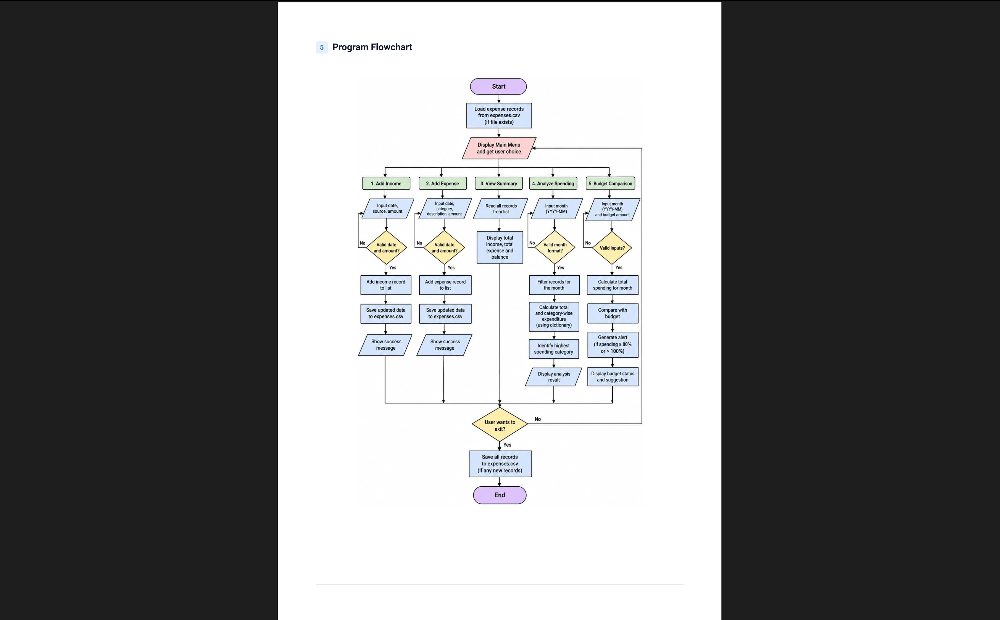
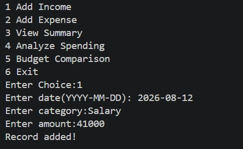
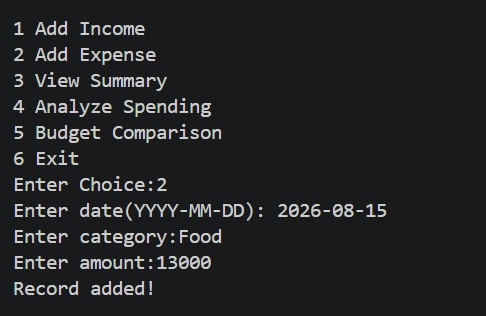
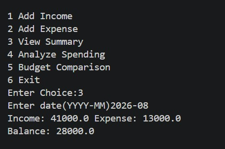
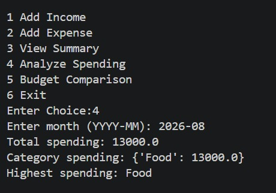
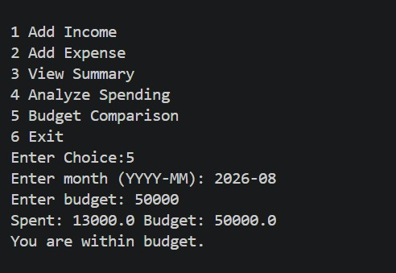

## Computational Thinking and Programming

Course Code: 2026CSAE100

## PYTHON PROJECT REPORT

## Personal Expense and Budget Analyzer

| Team Member | Student Name | Enrollment No. |
| --- | --- | --- |
| Member 1 (Team Leader) | Rudra Pratap Singh | S26CSEU1977 |
| Member 2 | Satwik Raghuvanshi | S26CSEU1976 |
| Member 3 | Nischay Kumar Sharma | S26CSEU1965 |
| Member 4 | Rishab Jain | S26CSEU1978 |
| Member 5 | Divyansh Jain | S26CSEU1981 |

Batch / Section:

B-56 / S-28


## 1 Problem Statement

The problem. Money comes in and goes out through several channels: allowance or salary, cash, card and online payments. Most people note a few of these down, forget the rest and never add them up. At the end of the month it is hard to say how much was received, how much was spent, or which kind of spending took the largest share. Without that picture, it is easy to cross a monthly spending limit without noticing.

Who faces it. Mainly students and young earners who live on a fixed monthly amount, but also anyone who wants a basic record of personal money without setting up a spreadsheet or a full finance application.

Why it is useful to solve. A clear monthly record shows where money actually goes, makes it easier to plan the next month, and gives an early warning before the budget is used up.

How this project helps. The Personal Expense and Budget Analyzer is a menu-driven Python program. The user enters income and expenses with a date, category and amount. The records are saved in a CSV file, so they are still there the next time the program runs. From the saved records the program can show a monthly summary, break spending down by category, name the highest-spending category, and compare a month’s spending with a budget entered by the user.

## 2 Project Objectives

- 1. Record income and expense transactions with a date, a category and an amount, accepting only real calendar dates that are not in the future.

- 2. Store the records in a CSV file (expense.csv) so that they are reloaded automatically when the program is started again.

- 3. Calculate the total income, total expense and balance for any month entered by the user.

- 4. Add up expenses category by category for a month and identify the highest-spending category.

- 5. Compare a month’s spending with a user-entered budget and display an alert once spending reaches 80% of the budget.

## 3 Main Features / Modules

The program is one file: a start-up block that loads the data, four helper functions and a main menu loop. Table 1 lists each feature.

*Table 1 Features and modules of the program*

| S. | Module / Feature | Description |
| --- | --- | --- |
| No. |   |   |
| 1 | Loading saved records | At start-up, expense.csv is read with csv.DictReader into the list |
|   |   | records. If the file does not exist yet, the program starts with an empty list. |
| 2 | Date validation | get_valid_date() keeps asking for a date in YYYY-MM-DD form until a |
|   |   | real calendar date is entered. leap() and days_in_month() handle |
|   |   | month lengths and leap years. Dates after 25 November 2026 are rejected. |
| 3 | Add income (option 1) | Takes a validated date, a category and an amount, and stores the record |
|   |   | with type Income. |
| 4 | Add expense (option 2) | Takes the same inputs and stores the record with type Expense. The |
|   |   | category is capitalised, so “food” and “Food” are grouped together. |


| S. | Module / Feature | Description |
| --- | --- | --- |
| No. |   |   |
| 5 | Monthly summary | For the month entered (YYYY-MM), adds up income and expenses and |
|   | (option 3) | prints the balance. |
| 6 | Spending analysis (option | Totals the month’s expenses, groups them by category in a dictionary, and |
|   | 4) | prints the highest-spending category. |
| 7 | Budget comparison | Compares the month’s total expenses with the user’s budget; prints an |
|   | (option 5) | alert once spending reaches 80% of the budget, otherwise reports that |
|   |   | spending is within budget. |
| 8 | Saving, exit and menu | save() writes the header and all records to expense.csv after every new |
|   | handling (option 6) | entry and again on exit. Any other menu input prints “Invalid choice!” and |
|   |   | the menu is shown again. |

## 4 Algorithm / Flowchart / Program Design

The program loads any saved records at start-up and then stays in a menu loop. Each choice either adds a record or reads the stored records to produce a result. While the program runs the records are kept in a list of dictionaries, and they are written to expense.csv whenever something changes.

## Data design

*Table 2 Fields of a transaction record, also the four columns of expense.csv (examples from the demonstration run)*

| Field | Purpose | Example |
| --- | --- | --- |
| date | Date of the transaction, entered as YYYY-MM-DD | 2026-08-15 |
| type | Income or Expense, set by the menu option chosen | Expense |
| category | Group of the transaction, first letter capitalised | Food |
| amount | Value of the transaction, stored as a decimal number | 13000.0 |

## Algorithm / Pseudocode

- 1. Start.

- 2. Import csv and create an empty list, records.

- 3. Read expense.csv into records; if the file does not exist, continue with the empty list.

- 4. Repeat until Exit is chosen: show the menu and read the choice.

- 5. Choice 1 or 2: ask for a valid date (a real calendar date, not in the future), a category and an amount; add the record as Income (1) or Expense (2); save to expense.csv; show “Record added!”.

- 6. Choice 3: read a month (YYYY-MM); add up the Income and Expense amounts of that month; show income, expense and balance = income − expense.

- 7. Choice 4: read a month; add each Expense of that month to the total and to its category in a dictionary; show the total, the category totals and the highest category.

- 8. Choice 5: read a month and a budget; spent = total expenses of the month; show spent and budget; if spent ≥ 0.8 × budget show the alert, otherwise “You are within budget.”

- 9. Choice 6: save the records, show “Data saved. Goodbye!” and leave the loop.

- 10. Any other input: show “Invalid choice!” and return to the menu.

- 11. Stop.


## Flowchart / Design

The flowchart below shows the overall flow of the program, from loading the data to the five menu options and the exit step.

*Figure 1 Program flowchart (as supplied with the project)*

Note: the flowchart is a general design. Where it differs in detail from the final program, the source code is the reference: the file is named expense.csv (the flowchart says expenses.csv); records hold date, type, category and amount (no separate source or description field); and the budget check gives one alert from 80% of the budget upwards. Options 3, 4 and 5 read the month as typed, without the separate format check drawn in the flowchart.


## 5 Python Concepts Used

The concepts below are all present in the source code; the second column says where each one appears.

*Table 3 Python concepts used in the project*

| Python Concept | Where / How It Is Used |
| --- | --- |
| Variables and Data Types | Text (str) for the choice, date and category; float for amounts, income, expense, |
|   | budget and spent; int for the year, month and day; bool as the result of leap(). |
|   | Python decides the type when a value is assigned, and float() and int() convert |
|   | the text typed by the user. |
| Conditional Statements | if / elif / else decide which menu option runs, whether a date is valid or in the |
|   | future, and whether the budget alert is shown. A one-line conditional expression |
|   | sets the type of a record: "Income" if ch=="1" else "Expense". |
| Loops | The main while True loop repeats the menu until option 6 uses break. A |
|   | second while loop in get_valid_date() repeats until a date is accepted. for loops |
|   | go through the records in options 3 and 4, and a generator expression inside |
|   | sum() totals the expenses in option 5. |
| Lists / Tuples / Sets / | records is a list of dictionaries, one per transaction. The dictionary categories |
| Dictionaries | maps each category to its total, updated with get(c, 0). Tuples are used to |
|   | compare dates, e.g. (y,m,day)>(2026,11,25), and to list the 30-day months (4, |
|   | 6, 9, 11). |
| Functions | Four user-defined functions: save(), leap(y), days_in_month(y, m) and |
|   | get_valid_date(). Built-in functions used include input, print, float, int, list, open, |
|   | sum and max. |
| File Handling | The file is opened with open("expense.csv","r",newline="") to read and |
|   | with mode "w" to write the header and all records, so the data is still available |
|   | the next time the program runs. |
| Exception Handling | try / except FileNotFoundError at start-up lets the program run normally when |
|   | expense.csv does not exist yet. Other input errors, such as text typed instead of a |
|   | number, are not handled in this version (see Section 11). |
| Libraries Used, if any | Only the built-in csv module: DictReader, DictWriter, writeheader() and |
|   | writerows(). No external packages are needed. |
| String Operations | strip() and split("-") break the typed date into year, month and day; capitalize() |
|   | tidies the category; startswith(month) selects the records that belong to a given |
|   | month. |
| Operators | Arithmetic (+, -, *, %), augmented assignment (+=), comparison (==, !=, >=, <=, >), |
|   | logical (and, or, not) and membership (in). |

## 6 Computational Feature

The main computational feature is the analysis of the saved records month by month. Dates are stored as text in YYYY-MM-DD form, so the records for a month are those whose date starts with the text YYYY- MM. Each analysis loops over the records, keeps the matching ones and calculates one of the following.


## Calculations performed

```
Balance = (sum of Income amounts) - (sum of Expense amounts)
Category total = sum of Expense amounts with the same category
Highest category = category with the largest total
Budget alert = spent >= 0.8 * budget
```

- Monthly income, expense and balance (option 3). Income and expense start at 0.0. For each record in the month the amount is added to one of them according to its type. The balance is income − expense and can be negative.

- Category-wise aggregation (option 4). The dictionary starts empty. For each expense in the month, categories[c] = categories.get(c, 0) + amount adds the amount to its category, creating the entry the first time the category appears.

- Highest-spending category (option 4). max(categories, key=categories.get) returns the category whose total is largest. It is printed only if the dictionary is not empty.

- Budget check (option 5). The month’s expenses are summed into spent. The alert is shown when spent is at least 0.8 times the budget, i.e. when 80% or more of the budget has been used; this includes spending that exceeds the budget.

## Worked example

The figures below are the ones used in the demonstration run shown in Section 7 (month 2026-08, budget 50000).

*Table 4 Worked example using the demonstration data*

| Step | Calculation | Result |
| --- | --- | --- |
| Income for 2026-08 | Salary = 41000 | 41000.0 |
| Expense for 2026-08 | Food = 13000 | 13000.0 |
| Balance | 41000 − 13000 | 28000.0 |
| Highest-spending category | Only Food has spending | Food |
| Alert threshold | 0.8 × 50000 | 40000 |
| Budget check | 13000 < 40000 | “You are within budget.” |

The behaviour around the threshold was checked with a budget of 50000 and different amounts of spending (Tests 6 to 8 in Section 8):

*Table 5 Budget check around the 80% threshold (budget = 50000)*

| Spent | Share of budget | Message printed |
| --- | --- | --- |
| 39999 | just below 80% | You are within budget. |
| 40000 | exactly 80% | Alert: Budget 80% used or exceeded! |
| 50000 | 100% | Alert: Budget 80% used or exceeded! |

The program does not print the percentage used; it only compares spent with 0.8 × budget. Spending below 80%, between 80% and 100%, and above 100% therefore give either “within budget” or the same single alert message.


## 7 Important Outputs / Screenshots

The screenshots below were taken while running the program. They follow one session in which an income and an expense for August 2026 were added and then analysed.

<div align="center">
  
  
  
  
  
</div>

## Screenshot 1

*Figure 2 Adding an income record (option 1)*

Option 1 asks for a date in YYYY-MM-DD form, a category and an amount. The record (Salary, 41000) is

accepted and “Record added!” is shown.

## Screenshot 2

*Figure 3 Adding an expense record (option 2)*

Option 2 uses the same prompts. The expense (Food, 13000 on 2026-08-15) is stored with type Expense.


## Screenshot 3

*Figure 4 Monthly summary for 2026-08 (option 3)*

The program adds the income and the expense for the month and prints the balance: 41000.0 − 13000.0

= 28000.0.

## Screenshot 4

*Figure 5 Spending analysis for 2026-08 (option 4)*

Total spending, the spending per category and the highest-spending category are printed. Here Food is

the only category, so it is also the highest.


## Screenshot 5

*Figure 6 Budget comparison for 2026-08 (option 5)*

With a budget of 50000 and 13000 spent, the program reports “You are within budget.”

## 8 Testing

The program was tested with normal inputs, boundary values around the 80% budget threshold, and invalid inputs. Tests 1 to 5 match the screenshots in Section 7. Tests 6 to 14 were run on the same source file with the inputs shown, and the actual output is quoted from the console.

*Table 6 Test cases and results*

| Test | Input | Expected Output | Actual Output | Result |
| --- | --- | --- | --- | --- |
| 1 | Normal: option 1; date 2026-08- | Income record saved | Record added! (category stored as | Pass |
|   | 12; category salary; amount |   | Salary) |   |
|   | 41000 |   |   |   |
| 2 | Normal: option 2; date 2026-08- | Expense record saved | Record added! (category stored as | Pass |
|   | 15; category food; amount 13000 |   | Food) |   |
| 3 | Monthly calculation: option 3; | Income 41000, expense | Income: 41000.0 Expense: | Pass |
|   | month 2026-08 | 13000, balance 28000 | 13000.0 / Balance: 28000.0 |   |
| 4 | Category analysis: option 4; | Total, category totals, | Total spending: 13000.0 / Category | Pass |
|   | month 2026-08 | highest category | spending: {'Food': 13000.0} / |   |
|   |   |   | Highest spending: Food |   |
| 5 | Budget below 80%: option 5; | Within budget | Spent: 13000.0 Budget: 50000.0 / | Pass |
|   | month 2026-08; budget 50000 |   | You are within budget. |   |
|   | (spent 13000) |   |   |   |
| 6 | Boundary: budget 50000; spent | Alert shown | Alert: Budget 80% used or | Pass |
|   | 40000 (exactly 80%) |   | exceeded! |   |
| 7 | Boundary: budget 50000; spent | Within budget | You are within budget. | Pass |
|   | 39999 (just below 80%) |   |   |   |
| 8 | Special: budget 50000; spent | Alert shown | Alert: Budget 80% used or | Pass |
|   | 50000 (100%) |   | exceeded! (same single message) |   |


| Test | Input | Expected Output | Actual Output | Result |
| --- | --- | --- | --- | --- |
| 9 | Invalid menu choice: 9 | Error message, menu | Invalid choice! followed by the | Pass |
|   |   | shown again | menu |   |
| 10 | Invalid date: 2026-02-30 | Date rejected, asked | invalid date, then the date prompt | Pass |
|   |   | again | again |   |
| 11 | Future date: 2027-01-01 | Date rejected, asked | Future Date not allowed, then the | Pass |
|   |   | again | date prompt again |   |
| 12 | No expense.csv present; option | Program starts and shows | Income: 0.0 Expense: 0.0 / Balance: | Pass |
|   | 3; month 2026-08 | zero totals | 0.0 |   |
| 13 | Date typed as text: abc | Error message, asked | ValueError; the program stops | Fail |
|   |   | again |   |   |
| 14 | Amount typed as text: abc | Error message, asked | ValueError; the program stops | Fail |
|   |   | again |   |   |

Tests 13 and 14 are failures of the current version: the program does not check that the date and the amount are made of digits, so non-numeric text ends the program with an error. These are listed as limitations, together with the proposed fixes, in Section 11.

## 9 Team Member Contributions

*Table 7 Roles and contributions of the team*

| Student Name | Enrollment No. | Contribution |
| --- | --- | --- |
| Rudra Pratap Singh (Leader) | S26CSEU1977 | Project Coordinator & Integration. Coordinates the team |
|   |   | and oversees the complete project. |
| Satwik Raghuvanshi | S26CSEU1976 | Documentation. Prepares the project report and |
|   |   | screenshots. |
| Nischay Kumar Sharma | S26CSEU1965 | Data & File Handling. Maintains the CSV file and the |
|   |   | transaction data. |
| Rishab Jain | S26CSEU1978 | Testing and Flowchart. Prepares the flowchart and tests the |
|   |   | program. |
| Divyansh Jain | S26CSEU1981 | Python Developer. Works on the main Python code and the |
|   |   | program logic. |

## 10 Challenges Faced and Learning

The difficulties below come from the design of the program and from its test results (Section 8). They describe what the code has to deal with, how it deals with it, and what each point teaches about Python. They are written from the code and the tests, so the team should confirm which of them it actually met while working on the project.


*Table 8 Challenges, how the program handles them, and what they teach*

| Challenge | How the program handles it | What it shows about Python |
| --- | --- | --- |
| Handling the CSV file | On the first run expense.csv does not exist, so reading | Data in a file and data in memory are |
| and keeping the | it sits inside try / except FileNotFoundError and the | different things; the csv module’s |
| records | program starts with an empty list. Every value read | DictReader and DictWriter move |
|   | back from the file is text, so amounts are converted | records between a file and a list of |
|   | with float() before they are added. save() rewrites the | dictionaries. |
|   | whole file after each new record and on exit. |   |
| Validating dates, | Months have different lengths, and February has 29 | A rule with exceptions, such as the |
| including leap years | days only in a leap year. leap() applies the rule year % 4 | leap-year rule, has to be written as one |
|   | == 0 and (year % 100 != 0 or year % 400 == 0), and | clear condition. Functions keep it in one |
|   | days_in_month() uses it to check the day. A date after | place. |
|   | 25 November 2026 is rejected. Test 10 (2026-02-30) |   |
|   | and Test 11 (2027-01-01) were rejected as expected. |   |
| Calculating monthly | Dates are stored as text, so a month is selected with | Choosing how data is stored decides |
| income, expense and | startswith("YYYY-MM"). Income and expense are added | how it can be searched later. Loops |
| balance | up separately by record type, and the balance is | with an if inside are enough to filter and |
|   | income − expense. The month typed in options 3 to 5 is | total records. |
|   | not checked, so “2026” would select the whole year |   |
|   | (see Table 9). |   |
| Implementing the | The check is spent >= budget * 0.8. Because of the >=, | Boundary values show whether a |
| 80% budget alert | spending of exactly 80% already gives the alert. This | comparison should use > or >=. One |
|   | was tested with a budget of 50000: 39999 gave “within | message is used for 80% and above, so |
|   | budget”, while 40000 and 50000 gave the alert. The | spending over 100% is not reported |
|   | program does not print the percentage used. | separately. |
| Testing different | Testing covered normal, boundary and invalid inputs. | Error messages such as ValueError |
| inputs and finding | Tests 13 and 14 (text typed instead of a number) stop | point to the exact line that failed. Tests |
| errors | the program with a ValueError. Both are recorded as | with invalid input find problems that |
|   | failed tests, and the fix is listed in Table 9: put the input | normal input never shows. |
|   | inside try / except ValueError in a loop. It was not |   |
|   | added to the submitted version. |   |

## Concepts and skills practised

- Writing a menu-driven program with a while loop and if / elif / else branches.

- Storing structured data in lists and dictionaries and processing it with for loops.

- Reading and writing CSV files with the csv module so that data stays between runs.

- Splitting a program into functions and validating input before using it.

- Testing a program with normal, boundary and invalid inputs and comparing actual output with the expected output.

## 11 Conclusion and Future Improvements

## Conclusion

The Personal Expense and Budget Analyzer meets the objectives set for it. It records income and expenses with validated dates, keeps them in expense.csv between runs, and produces a monthly summary, a category-wise breakdown with the highest-spending category, and a budget check with an alert from 80% of the budget. Twelve of the fourteen tests in Section 8 passed; the two that failed


concern text typed in place of numbers. The project shows how a small Python program can solve an everyday problem using functions, loops, conditions, dictionaries and file handling.

## Limitations of the current version and proposed improvements

The first column describes how the present program behaves. The second column is a proposal and is not part of the submitted code.

*Table 9 Current limitations and proposed improvements*

| Current version | Proposed improvement |
| --- | --- |
| Text typed instead of a number in the date or the | Put the input inside try / except ValueError in a loop, and |
| amount ends the program with an error (Tests 13 and | ask again after an error message. |
| 14). |   |
| The month entered in options 3, 4 and 5 is not checked. | Check the month format with the same kind of validation |
| It is matched by prefix, so “2026” selects the whole year | used for dates. |
| and a mistyped month simply gives zero totals. |   |
| The latest allowed date is fixed in the code (25 November | Use the current date from Python’s datetime module. |
| 2026). |   |
| Negative amounts are accepted. | Accept only amounts greater than zero. |
| One alert message is used from 80% of the budget | Print the percentage used and give separate messages |
| upwards, and the percentage used is not shown. | for the 80–100% range and for spending above the |
|   | budget. |
| save() opens the file without a with block or an explicit | Use with open(...) so that the file is always closed |
| close. | properly. |
| Records cannot be edited or deleted from the program. | Add menu options to edit or delete a record. |

Further enhancements. A graphical user interface, charts of monthly spending by category (for example with matplotlib), exporting a monthly report to a file, and separate budgets for each category.

## 12 References / Acknowledgements

- 1. Python Software Foundation. “csv — CSV File Reading and Writing.” Python 3 documentation. https://docs.python.org/3/library/csv.html

- 2. Python Software Foundation. “Built-in Functions.” Python 3 documentation. https://docs.python.org/3/library/functions.html

- 3. Python Software Foundation. “Built-in Types: Text Sequence Type (str) and string methods.” Python 3 documentation. https://docs.python.org/3/library/stdtypes.html

- 4. Python Software Foundation. “Errors and Exceptions.” The Python Tutorial. https://docs.python.org/3/tutorial/errors.html

- 5. Python Software Foundation. “Reading and Writing Files.” The Python Tutorial. https://docs.python.org/3/tutorial/inputoutput.html

- 6. AI tool: Claude (Anthropic) was used to help format and draft this report and the project presentation.

Declaration: We confirm that we understand the submitted project and have acknowledged the external resources used during development.


## Appendix: Python Source Code

File: Personal_Budget_and_Expense_Analyser.py (96 lines). The program is reproduced exactly as submitted; one long line (line 45) continues on the next row.

```
1 import csv # Import the CSV module for reading and writing CSV files
2 records=[]
3 try: # Try to read existing data
4 with open("expense.csv","r",newline="") as f:
5 records=list(csv.DictReader(f))
6 except FileNotFoundError: # If file doesn't exist, we just continue with an empty list
7 pass
8
9 def save(): # Save the records to a CSV file
10 f=open("expense.csv","w",newline="")
11 fields=["date","type","category","amount"]
12 writer=csv.DictWriter(f, fieldnames=fields)
13 writer.writeheader()
14 writer.writerows(records)
15
16 def leap(y): # Check if a year is a leap year
17 return y%4==0 and (y%100!=0 or y%400==0)
18
19 def days_in_month(y,m): # Return the number of days in a given month of a given year
20 if m==2:
21 return 29 if leap(y)else 28
22 return 30 if m in (4,6,9,11) else 31
23
24 def get_valid_date(): # Get a valid date from the user
25 while True:
26 d=input("Enter date(YYYY-MM-DD): ").strip()
27 parts=d.split('-')
28 y,m,day=int(parts[0]),int(parts[1]),int(parts[2])
29 if not 1<=m<=12 or not 1<=day<=days_in_month(y,m):
30 print("invalid date")
31 continue
32 elif (y,m,day)>(2026,11,25):
33 print("Future Date not allowed")
34 continue
35 return d
36 while True: # Main loop for user interaction
37 print("\n1 Add Income \n2 Add Expense")
38 print("3 View Summary \n4 Analyze Spending")
39 print("5 Budget Comparison \n6 Exit")
40 ch=input("Enter Choice:")
41 if ch in ["1","2"]: # Add income or expense
42 date = get_valid_date()
43 category = input("Enter category:").capitalize()
44 amount = float(input("Enter amount:"))
45 records.append({"date": date,"type": "Income" if ch=="1" else "Expense","category":
category,"amount": amount})
46 save()
47 print("Record added!")
48 elif ch=="3": # View summary of income and expenses for a given month
49 D=input("Enter date(YYYY-MM)")
50 income=0.0
51 expense=0.0
52 for i in records: # Loop through all records
```


```
53 if i['date'].startswith(D):
54 if i['type'] == "Income":
55 income+=float(i['amount'])
56 if i['type'] == "Expense":
57 expense+=float(i['amount'])
58 print("Income:", income, "Expense:", expense)
59 print("Balance:", income - expense)
60
61 elif ch == "4": # Analyze spending for a given month
62 month = input("Enter month (YYYY-MM): ")
63 total = 0
64 categories = {}
65
66 for r in records: # Loop through all records
67 if r["type"] == "Expense" and r["date"].startswith(month):
68 total += float(r["amount"])
69 c = r["category"]
70 categories[c] = categories.get(c, 0) + float(r["amount"])
71
72 print("Total spending:", total)
73 print("Category spending:", categories)
74 if categories:
75 print("Highest spending:", max(categories, key=categories.get))
76
77 elif ch == "5": # Compare spending against a budget for a given month
78 month = input("Enter month (YYYY-MM): ")
79 budget = float(input("Enter budget: "))
80 spent = sum(float(r["amount"]) for r in records
81 if r["type"] == "Expense"
82 and r["date"].startswith(month))
83
84 print("Spent:", spent, "Budget:", budget)
85 if spent >= budget * 0.8:
86 print("Alert: Budget 80% used or exceeded!")
87 else:
88 print("You are within budget.")
89
90 elif ch == "6": # Exit the program
91 save()
92 print("Data saved. Goodbye!")
93 break
94
95 else: # Handle invalid choices
96 print("Invalid choice!")
```
